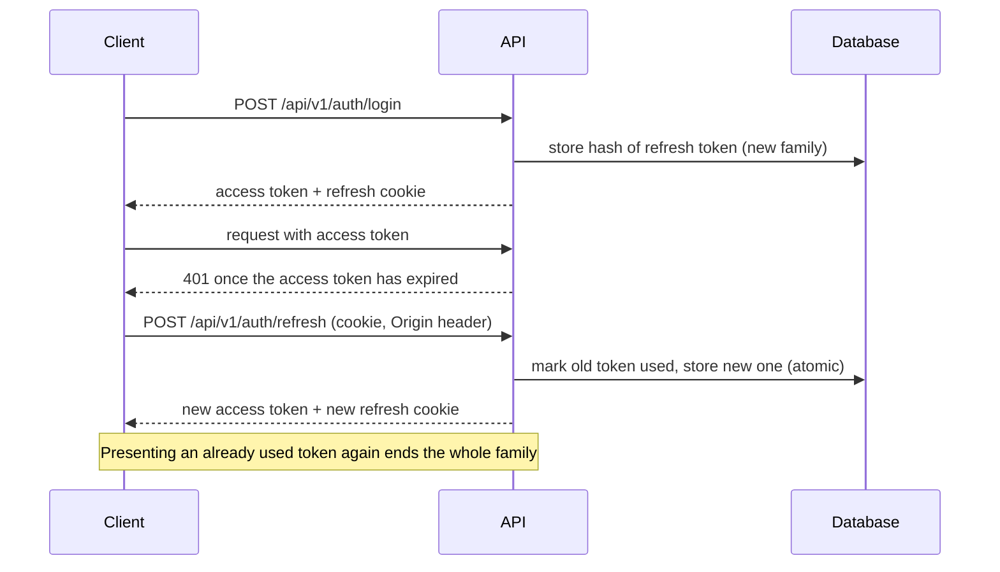
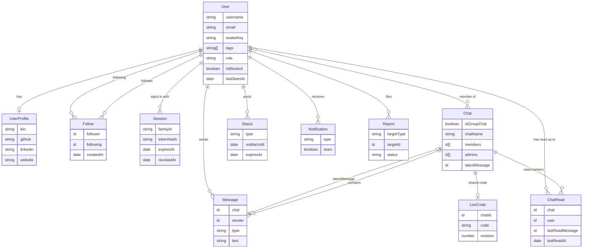

# DevSphere (Backend)

DevSphere is a social platform for developers to connect, chat and share code.
This repository contains the backend: a REST API and a Socket.IO server built
with Node.js, Express and MongoDB.

## Features

- Registration and login with short-lived access tokens and rotating refresh tokens
- Developer profiles (bio, links, tags, avatar upload to S3)
- Follow / unfollow, tags and tag search
- One-to-one and group chat, with text and code messages
- Real-time delivery, typing indicators and online presence over Socket.IO
- 24-hour status posts (text, image, video)
- Server-side syntax highlighting for code snippets
- Shared live code document per chat
- Notifications, content reports and basic admin endpoints

## Tech stack

- Node.js 20+ (ES modules), Express 5
- MongoDB with Mongoose
- Socket.IO
- Redis (optional, used for online presence)
- AWS S3 for uploaded media
- pnpm, Vitest, ESLint and Prettier

## Getting started

Requirements: Node.js 20 or newer, pnpm (via Corepack or a global install) and a MongoDB instance.

```bash
corepack enable
pnpm install
cp .env.example .env   # then fill in the values
pnpm dev               # or: pnpm start
```

The server listens on `PORT` (default `5000`). `GET /healthz` reports whether
the process is up and connected to the database.

## Environment variables

Copy `.env.example` to `.env` and set:

| Variable                   | Required    | Purpose                                                                                                           |
| -------------------------- | ----------- | ----------------------------------------------------------------------------------------------------------------- |
| `MONGO_URI`                | yes         | MongoDB connection string                                                                                         |
| `JWT_SECRET`               | yes         | Secret used to sign tokens, at least 32 characters                                                                |
| `PORT`                     | no          | HTTP port, defaults to `5000`                                                                                     |
| `NODE_ENV`                 | no          | `development`, `test` or `production`                                                                             |
| `MONGO_AUTO_INDEX`         | no          | `true` or `false`; build missing indexes at startup, default `true` except in production                          |
| `DOCS_ENABLED`             | no          | `true` or `false`; serve the API docs page and OpenAPI document, default `true` except in production              |
| `LOG_LEVEL`                | no          | `fatal`, `error`, `warn`, `info`, `debug`, `trace` or `silent`, default `info`                                    |
| `LOG_PRETTY`               | no          | `true` for human readable logs instead of JSON, default `false`                                                   |
| `METRICS_ENABLED`          | no          | `true` to serve Prometheus metrics at `/metrics`, default `false`                                                 |
| `METRICS_TOKEN`            | no          | When set, `/metrics` needs this value as a bearer token                                                           |
| `CORS_ORIGINS`             | no          | Comma separated browser origins allowed to call the API (none if empty)                                           |
| `TRUST_PROXY`              | no          | Number of reverse proxies in front of the app (recommended), or a list of their addresses or subnets; default `0` |
| `ACCESS_TOKEN_TTL`         | no          | Access token lifetime (`30s`, `15m`, `2h`, `1d`), default `15m`                                                   |
| `REFRESH_TOKEN_TTL_DAYS`   | no          | Refresh token lifetime in days, default `30`                                                                      |
| `COOKIE_SECURE`            | no          | `true` when served over HTTPS, so the refresh cookie is `Secure`                                                  |
| `REFRESH_RATE_LIMIT_MAX`   | no          | Refresh requests per 15 minutes, default `60`                                                                     |
| `REDIS_URL`                | no          | Redis URL, to run several instances (see Scaling); the app works without it                                       |
| `LIVE_CODE_FLUSH_MS`       | no          | Milliseconds live code edits wait before they are saved, default `2000`                                           |
| `REDIS_KEY_PREFIX`         | no          | Prefix for the Redis keys the app writes, default none                                                            |
| `RATE_LIMIT_MAX`           | no          | Requests per 15 minutes for `/api`, default `300`                                                                 |
| `AUTH_RATE_LIMIT_MAX`      | no          | Login and register requests per 15 minutes, default `10`                                                          |
| `HIGHLIGHT_RATE_LIMIT_MAX` | no          | Snippet highlight requests per minute, default `30`                                                               |
| `AWS_ACCESS_KEY`           | for uploads | AWS access key id (optional if the environment provides AWS credentials)                                          |
| `AWS_SECRET_KEY`           | for uploads | AWS secret access key                                                                                             |
| `AWS_REGION`               | for uploads | AWS region of the bucket                                                                                          |
| `AVATAR_BUCKET`            | for uploads | S3 bucket for avatars and status media                                                                            |
| `MEDIA_URL_TTL_SECONDS`    | no          | Lifetime of signed media links, default `300`, at most `3600`                                                     |

The server exits at startup if `MONGO_URI` or `JWT_SECRET` is missing, if
`JWT_SECRET` is shorter than 32 characters, if a duration or count above is
invalid, or if it cannot connect to MongoDB.

Behind a reverse proxy, set `TRUST_PROXY` to the number of proxies in front of
the app (a hop count is the recommended value in production) so rate limiting
sees the real client address. A comma separated list of proxy addresses or
subnets (`10.0.0.0/8, loopback`) is also accepted. With the default `0`
forwarded headers are ignored. A bare `true` trusts every client's
`X-Forwarded-For` header, so any client can choose the address the rate limits
see; it still works but logs a warning at startup.

## Authentication

Signing in (`POST /api/v1/auth/login`, or registering) returns two things:

- an access token in the JSON body (`token`, with `expiresIn` in seconds). It is
  a JWT that lives for `ACCESS_TOKEN_TTL` (15 minutes by default) and is sent as
  `Authorization: Bearer <token>`.
- a refresh token in an `httpOnly` cookie named `refresh_token`
  (`SameSite=Strict`, `Secure` when `COOKIE_SECURE=true`, path `/api/v1/auth`). It
  is a random value that never appears in a response body, and only a SHA-256
  hash of it is stored.

Every login is a session family. Each refresh replaces the refresh token with a
new one in the same family:



Details:

- A refresh token that was already used is rejected. If it comes back more than
  10 seconds after it was rotated, the whole login (family) is revoked and the
  user has to sign in again. Inside those 10 seconds the request is only
  rejected, so two parallel requests from one client do not log the user out.
- Refresh and logout only answer requests whose `Origin` header is in
  `CORS_ORIGINS`. A missing or different origin gets 403. Clients send the
  cookie with `credentials: "include"` from an allowed origin.
- Blocking a user, changing a password (other logins only) and `logout-all`
  revoke sessions. Access tokens of a revoked login stop working immediately.
- Sockets use the access token and are closed when it expires or the login
  ends. Refresh, then reconnect with the new token.
- Tokens issued before this change (7 day tokens without a session) are no
  longer accepted. Everyone signs in once more.

## Data model



The user record owns the username, avatar and tags; the profile only holds the
bio and links. A follow is one `Follow` document with a unique
`(follower, following)` pair, so following is safe to repeat or race. Each chat
points at its newest message through `latestMessage`, which drives the chat list
order and preview. A report targets a message, a status or a user (by
`targetType` and `targetId`) and stays on record, marked `resolved`, after an
admin acts on it.

## Migrations and indexes

Data changes ship as ordered, repeatable migrations in `migrations/`. They never
run when the server starts.

```bash
pnpm migrate --dry-run   # report what would change, write nothing
pnpm migrate             # apply pending migrations
pnpm db:indexes          # create missing indexes and drop stale ones
```

Applied steps are recorded in the `migrations` collection, and every step is
safe to run more than once. When upgrading an existing database, run
`pnpm migrate` first and `pnpm db:indexes` after it (the unique indexes need the
cleaned-up data). Back up the database before the first run.

| Step                            | What it does                                                                                                                             |
| ------------------------------- | ---------------------------------------------------------------------------------------------------------------------------------------- |
| `001-user-timestamps`           | Fills `createdAt` (from the id when missing) and `updatedAt` on users                                                                    |
| `002-follows-from-user-arrays`  | Turns the embedded follower and following arrays into `Follow` documents, skipping duplicates and unknown users, then removes the arrays |
| `003-profile-fields-to-user`    | Moves profile-only avatar and tags onto the user (tags are merged, at most 20) and removes the profile copies                            |
| `004-chat-latest-message`       | Sets `latestMessage` on chats that already have messages                                                                                 |
| `005-merge-duplicate-live-code` | Keeps the most recently updated live code document per chat                                                                              |
| `006-report-status`             | Gives reports a status and resolves repeat open reports from the same user                                                               |

Mongoose builds missing indexes at startup when `MONGO_AUTO_INDEX` is `true`.
That is the default, except when `NODE_ENV=production` (the Docker image sets
it), where indexes are synced explicitly with `pnpm db:indexes` instead. Use
`pnpm db:indexes --dry-run` to see the difference first. The compose file turns
startup indexing on for the local database.

## Operations

### Logging and request ids

Logs are JSON lines on stdout (set `LOG_PRETTY=true` for readable text while
developing). `LOG_LEVEL` sets the level, `info` by default; the tests run
silent. One line is written per request with the method, route pattern (never
the real path or ids), status, duration in milliseconds and request id, plus a
few lines for startup, shutdown, sockets and errors. Expected client errors
(4xx) are logged at `info`, an unconfigured upload as a warning, and only
unexpected failures as errors (with the stack). Authorization headers,
cookies, passwords and tokens are redacted and request bodies are not logged.
Socket log lines carry the connection id (`socketId`) and the verified `userId`.

Every response has an `X-Request-Id` header. A request id sent by the client is
kept if it is 1 to 64 characters of letters, digits, `.`, `_` or `-`; otherwise
a new one is made. The same id is `requestId` in every error body and in the log
line of the request, so a reported error can be found in the logs.

### Metrics

Set `METRICS_ENABLED=true` to serve Prometheus metrics at `GET /metrics`
(not versioned, not rate limited, off otherwise). If `METRICS_TOKEN` is set the
request needs `Authorization: Bearer <token>`; without a token anyone who can
reach the port can read the metrics, so keep it on a private network. Exposed:

- the default Node.js process metrics
- `http_request_duration_seconds` (histogram; labels `method`, `route` and
  `status_class`, where `route` is the pattern such as `/api/v1/users/:id/follow`)
- `socket_connections` (gauge) and `socket_events_total` (counter by `event`)
- `auth_refresh_total` (counter by `outcome`: `rotated`, `reuse_detected` or
  `rejected`)

No label ever holds a user id, email or token. A scrape configuration:

```yaml
scrape_configs:
  - job_name: devsphere
    metrics_path: /metrics
    scrape_interval: 15s
    # Only when METRICS_TOKEN is set:
    authorization:
      type: Bearer
      credentials_file: /etc/prometheus/devsphere-metrics-token
    static_configs:
      - targets: ["devsphere:5000"]
```

### Health

- `GET /healthz`: liveness. 200 while MongoDB is connected, 503 otherwise.
- `GET /readyz`: readiness. 200 only when MongoDB is connected, 503 otherwise.
  The body also reports Redis as `up`, `down` or `disabled`; Redis is optional
  and never makes the app unready.

Both are unversioned and need no token. The Docker `HEALTHCHECK` uses `/readyz`.

### Shutdown and crashes

On `SIGTERM` or `SIGINT` the server stops accepting connections, closes the
sockets, Redis and MongoDB and exits 0. If that takes longer than 10 seconds it
exits 1. After an unhandled promise rejection or an uncaught exception it logs
the error, tries the same graceful shutdown and exits 1, so a supervisor
restarts it.

## Admin access

There is no default admin. Register a normal account, then promote it:

```bash
pnpm make-admin you@example.com
```

Admin routes (`/api/v1/admin/...`) return 403 for everyone else. The script reads
`MONGO_URI` from the environment or `.env`.

## Uploads

Avatars (images, up to 2 MB) and status media (images or videos, up to 20 MB)
are stored in S3 under generated keys. Use a private bucket with public access
blocked. API responses contain short-lived signed links (see
`MEDIA_URL_TTL_SECONDS`), so clients should not store or cache those URLs.
Stored files of statuses are deleted once the status is no longer visible.

## Real-time connections

Socket.IO connections must send the current access token:

```js
const socket = io(serverUrl, { auth: { token } });
```

Rooms are managed by the server. A client asks to join a chat with
`join-chat` and the chat id; this only succeeds for chat members. Notifications
(`receive-notification`) are created by the server and delivered to the
signed-in user.

Messages are sent with `POST /api/v1/chat/message` or the `send-message` event.
Both are handled by the server, which saves the message and delivers it to the
chat's members; clients never choose the recipients. The socket event is
acknowledged with the stored message id and time. Live code edits carry a
revision, and a stale edit is answered with a conflict and the current
document. Read markers, read receipts and online presence are described in
[docs/socket-events.md](docs/socket-events.md).

## Scaling

One instance needs nothing but MongoDB. To run several instances behind a load
balancer, set `REDIS_URL` to the same Redis on all of them (and `REDIS_KEY_PREFIX`
if the Redis is shared with something else).

| Needs Redis to work across instances | Without Redis                                     |
| ------------------------------------ | ------------------------------------------------- |
| Socket.IO rooms and events (adapter) | Each instance only reaches its own sockets        |
| HTTP and socket rate limits          | Each instance counts on its own, in memory        |
| Online presence (connection counts)  | Each instance only knows its own connections      |
| Live code working copies             | Each instance keeps its own, so edits can diverge |

Everything else (accounts, chats, messages, read markers, last seen times) is
stored in MongoDB and is shared anyway.

- Socket.IO clients start with HTTP long polling before upgrading to a
  WebSocket, so the load balancer needs sticky sessions, or clients should
  connect with `transports: ["websocket"]`.
- If Redis goes down the instances keep running. Rate limits and presence fall
  back to memory with a warning in the log, the adapter reconnects by itself,
  and removing a member, blocking a user or ending a login still closes the
  sockets of the instance that handles the request.
- Presence entries expire if an instance disappears without closing its
  connections, so users do not stay online forever. Live code edits not yet
  written to MongoDB when an instance is killed are lost (at most
  `LIVE_CODE_FLUSH_MS` of typing).
- `/readyz` reports Redis as a field only: a Redis outage does not make an
  instance unready.

## API

All paths start with `/api/v1`. Unversioned `/api/...` paths answer 404.

The full reference is generated from the same schemas the API validates with:

- interactive docs at `/api/v1/docs`
- the OpenAPI 3.1 document at `/api/v1/openapi.json`
- real-time events in [docs/socket-events.md](docs/socket-events.md)

The docs are on by default and off in production unless `DOCS_ENABLED=true`.

Conventions:

- Everything except the routes marked public needs `Authorization: Bearer <access token>`.
- Errors always look like `{ "error": { "code", "message", "details"?, "requestId" } }` with a stable `code` such as `VALIDATION_ERROR`, `UNAUTHENTICATED`, `FORBIDDEN`, `NOT_FOUND`, `CONFLICT`, `RATE_LIMITED` or `UPLOADS_NOT_CONFIGURED`. Validation errors list the failing fields in `details`, and `requestId` matches the `X-Request-Id` response header.
- Lists take `limit` (default 30, at most 100) and `cursor`, and answer `{ "items": [...], "nextCursor": "..." | null }`. Pass `nextCursor` back as `cursor` for the next page. Cursors are opaque; an invalid one is a 400. Chat messages come newest first, so a later page holds older messages.
- Rate limited responses (429) carry a `Retry-After` header, and every response has `RateLimit` and `RateLimit-Policy` headers.
- Browsers can call the API from the origins in `CORS_ORIGINS`: credentials are allowed for them only, and the rate limit headers are readable.

Auth (`/api/v1/auth`)

- `POST /api/v1/auth/register` and `POST /api/v1/auth/login` (public): create or sign in, returns the access token and sets the refresh cookie.
- `POST /api/v1/auth/refresh` (cookie, allowed origin): rotate the refresh token and get a new access token.
- `POST /api/v1/auth/logout` (cookie, allowed origin): end the current login and clear the cookie.
- `POST /api/v1/auth/logout-all`: end every login of the user.
- `GET /api/v1/auth/sessions`: list active logins (`id`, `createdAt`, `lastUsedAt`, `userAgent`, `current`).
- `DELETE /api/v1/auth/sessions/:id`: end one login.
- `POST /api/v1/auth/change-password`: needs `currentPassword` and `newPassword`, ends the other logins.

Other areas

- `/profile`: `POST /` (bio, links, tags and an optional `avatar` file), `GET /me`, `GET /:userId` (public). Responses include follower and following counts.
- `/users`: follow and unfollow, paged `GET /:id/followers` and `/following`, `PATCH /me/tags`, paged `GET /?tag=`.
- `/chat`: `POST /access`, paged `GET /` (with `unreadCount`), `POST /message`, paged `GET /message/:chatId`, `PUT /:chatId/read` (move your read marker forward).
- `/presence`: `GET /?ids=a,b,c` (up to 100 user ids): online state and last seen time of yourself, people you share a chat with and people you follow. Other ids are left out.
- `/group`: `POST /create`, `PATCH /add`, `/remove`, `/rename`.
- `/status`: `POST /` (text, image or video), paged `GET /feed`.
- `/snippets/highlight` (public, rate limited), `/live-code/:chatId` (with its `revision`), paged `/notifications`, `/report` (the target must exist; one open report per user and target).
- `/admin` (admin role only): paged users, block and unblock, paged `GET /reports?status=open|resolved|all`, `DELETE /remove/:type/:id` (message, status, or user, which blocks the account).
- `GET /healthz` (not versioned): process and database status.

## Scripts

| Command                   | What it does                                           |
| ------------------------- | ------------------------------------------------------ |
| `pnpm dev`                | Start with automatic restarts                          |
| `pnpm start`              | Start the server                                       |
| `pnpm lint`               | Run ESLint                                             |
| `pnpm format`             | Format the code with Prettier                          |
| `pnpm format:check`       | Check formatting                                       |
| `pnpm test`               | Run the test suite                                     |
| `pnpm make-admin <email>` | Give an existing user the admin role                   |
| `pnpm migrate`            | Apply pending data migrations (`--dry-run` to preview) |
| `pnpm db:indexes`         | Sync database indexes with the models                  |

## Testing

The tests are integration tests and need a real MongoDB and Redis. Point them
at throwaway instances:

```bash
export TEST_MONGO_URI=mongodb://127.0.0.1:27017
export REDIS_URL=redis://127.0.0.1:6379
pnpm test
```

The tests use a separate `devsphere_test` database and drop it when finished.
Never point `TEST_MONGO_URI` at a database you care about.

## Docker

```bash
cp .env.example .env   # set JWT_SECRET at least
docker compose up --build
```

Compose starts the app together with MongoDB and Redis. The app overrides
`MONGO_URI` and `REDIS_URL` to point at those containers, and MongoDB is not
published to the host.

## Deployment

Configuration is done entirely through environment variables (see above). Any
host that can run the Docker image or `pnpm start` with those variables set
will work.

## Project structure

```
.
├── app.js            Express app and middleware order
├── server.js         Startup, shutdown, database connection
├── socket.js         Socket.IO server
├── config/           The validated settings and the Redis connection
├── routes/           Paths, middleware and controllers
├── schemas/          zod schemas for input and responses
├── controllers/      Read input, call a service, shape the response
├── services/         Business logic
├── models/           Mongoose schemas
├── middlewares/      Auth, validation, errors, logging, CORS, limits
├── utils/            Small helpers (tokens, pagination, logging, uploads)
├── migrations/       Ordered data migrations
├── scripts/          pnpm migrate, db:indexes, make-admin, smoke test
├── openapi/          The OpenAPI document builder
├── docs/             Architecture and socket events
└── tests/
```

How the layers fit together is described in [docs/architecture.md](docs/architecture.md).

## Contributing

Pull requests are welcome. For larger changes, please open an issue first.
Run `pnpm lint` and `pnpm test` before submitting.

## Author

Prabodh Raj U R
