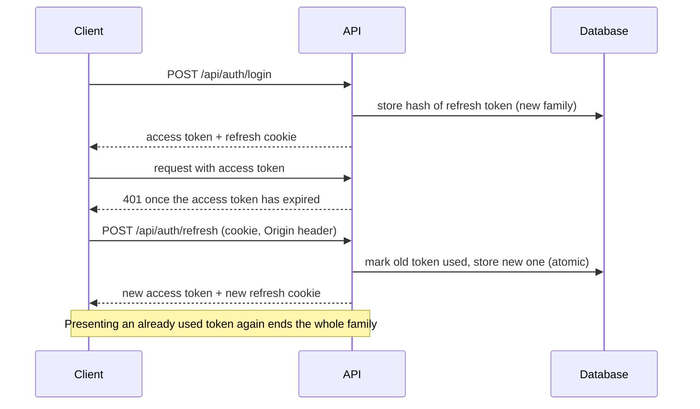

# DevSphere (Backend)

DevSphere is a social platform for developers to connect, chat and share code.
This repository contains the backend: a REST API and a Socket.IO server built
with Node.js, Express and MongoDB.

## Features

- Registration and login with short-lived access tokens and rotating refresh tokens
- Developer profiles (bio, links, tags, avatar upload to S3)
- Follow / unfollow, tags and tag search
- One-to-one and group chat, with text and code messages
- Real-time delivery, typing indicators and online presence over Socket.IO
- 24-hour status posts (text, image, video)
- Server-side syntax highlighting for code snippets
- Shared live code document per chat
- Notifications, content reports and basic admin endpoints

## Tech stack

- Node.js 20+ (ES modules), Express 5
- MongoDB with Mongoose
- Socket.IO
- Redis (optional, used for online presence)
- AWS S3 for uploaded media
- pnpm, Vitest, ESLint and Prettier

## Getting started

Requirements: Node.js 20 or newer, pnpm (via Corepack or a global install) and a MongoDB instance.

```bash
corepack enable
pnpm install
cp .env.example .env   # then fill in the values
pnpm dev               # or: pnpm start
```

The server listens on `PORT` (default `5000`). `GET /healthz` reports whether
the process is up and connected to the database.

## Environment variables

Copy `.env.example` to `.env` and set:

| Variable                   | Required    | Purpose                                                                                  |
| -------------------------- | ----------- | ---------------------------------------------------------------------------------------- |
| `MONGO_URI`                | yes         | MongoDB connection string                                                                |
| `JWT_SECRET`               | yes         | Secret used to sign tokens, at least 32 characters                                       |
| `PORT`                     | no          | HTTP port, defaults to `5000`                                                            |
| `NODE_ENV`                 | no          | `development`, `test` or `production`                                                    |
| `MONGO_AUTO_INDEX`         | no          | `true` or `false`; build missing indexes at startup, default `true` except in production |
| `CORS_ORIGINS`             | no          | Comma separated browser origins allowed to call the API (none if empty)                  |
| `TRUST_PROXY`              | no          | Number of reverse proxies in front of the app, default `0`                               |
| `ACCESS_TOKEN_TTL`         | no          | Access token lifetime (`30s`, `15m`, `2h`, `1d`), default `15m`                          |
| `REFRESH_TOKEN_TTL_DAYS`   | no          | Refresh token lifetime in days, default `30`                                             |
| `COOKIE_SECURE`            | no          | `true` when served over HTTPS, so the refresh cookie is `Secure`                         |
| `REFRESH_RATE_LIMIT_MAX`   | no          | Refresh requests per 15 minutes, default `60`                                            |
| `REDIS_URL`                | no          | Redis URL for online presence; the app works without it                                  |
| `RATE_LIMIT_MAX`           | no          | Requests per 15 minutes for `/api`, default `300`                                        |
| `AUTH_RATE_LIMIT_MAX`      | no          | Login and register requests per 15 minutes, default `10`                                 |
| `HIGHLIGHT_RATE_LIMIT_MAX` | no          | Snippet highlight requests per minute, default `30`                                      |
| `AWS_ACCESS_KEY`           | for uploads | AWS access key id (optional if the environment provides AWS credentials)                 |
| `AWS_SECRET_KEY`           | for uploads | AWS secret access key                                                                    |
| `AWS_REGION`               | for uploads | AWS region of the bucket                                                                 |
| `AVATAR_BUCKET`            | for uploads | S3 bucket for avatars and status media                                                   |
| `MEDIA_URL_TTL_SECONDS`    | no          | Lifetime of signed media links, default `300`, at most `3600`                            |

The server exits at startup if `MONGO_URI` or `JWT_SECRET` is missing, if
`JWT_SECRET` is shorter than 32 characters, if a duration or count above is
invalid, or if it cannot connect to MongoDB.

Behind a reverse proxy, set `TRUST_PROXY` to the number of proxies so rate
limiting sees the real client address. With the default `0` forwarded headers
are ignored.

## Authentication

Signing in (`POST /api/auth/login`, or registering) returns two things:

- an access token in the JSON body (`token`, with `expiresIn` in seconds). It is
  a JWT that lives for `ACCESS_TOKEN_TTL` (15 minutes by default) and is sent as
  `Authorization: Bearer <token>`.
- a refresh token in an `httpOnly` cookie named `refresh_token`
  (`SameSite=Strict`, `Secure` when `COOKIE_SECURE=true`, path `/api/auth`). It
  is a random value that never appears in a response body, and only a SHA-256
  hash of it is stored.

Every login is a session family. Each refresh replaces the refresh token with a
new one in the same family:



Details:

- A refresh token that was already used is rejected. If it comes back more than
  10 seconds after it was rotated, the whole login (family) is revoked and the
  user has to sign in again. Inside those 10 seconds the request is only
  rejected, so two parallel requests from one client do not log the user out.
- Refresh and logout only answer requests whose `Origin` header is in
  `CORS_ORIGINS`. A missing or different origin gets 403. Clients send the
  cookie with `credentials: "include"` from an allowed origin.
- Blocking a user, changing a password (other logins only) and `logout-all`
  revoke sessions. Access tokens of a revoked login stop working immediately.
- Sockets use the access token and are closed when it expires or the login
  ends. Refresh, then reconnect with the new token.
- Tokens issued before this change (7 day tokens without a session) are no
  longer accepted. Everyone signs in once more.

## Admin access

There is no default admin. Register a normal account, then promote it:

```bash
pnpm make-admin you@example.com
```

Admin routes (`/api/admin/...`) return 403 for everyone else. The script reads
`MONGO_URI` from the environment or `.env`.

## Uploads

Avatars (images, up to 2 MB) and status media (images or videos, up to 20 MB)
are stored in S3 under generated keys. Use a private bucket with public access
blocked. API responses contain short-lived signed links (see
`MEDIA_URL_TTL_SECONDS`), so clients should not store or cache those URLs.
Stored files of statuses are deleted once the status is no longer visible.

## Real-time connections

Socket.IO connections must send the current access token:

```js
const socket = io(serverUrl, { auth: { token } });
```

Rooms are managed by the server. A client asks to join a chat with
`join-chat` and the chat id; this only succeeds for chat members. Notifications
(`receive-notification`) are created by the server and delivered to the
signed-in user.

## API

All paths start with `/api`. Everything except the routes marked public needs
`Authorization: Bearer <access token>`.

Auth (`/api/auth`)

- `POST /api/auth/register` and `POST /api/auth/login` (public): create or sign in, returns the access token and sets the refresh cookie.
- `POST /api/auth/refresh` (cookie, allowed origin): rotate the refresh token and get a new access token.
- `POST /api/auth/logout` (cookie, allowed origin): end the current login and clear the cookie.
- `POST /api/auth/logout-all`: end every login of the user.
- `GET /api/auth/sessions`: list active logins (`id`, `createdAt`, `lastUsedAt`, `userAgent`, `current`).
- `DELETE /api/auth/sessions/:id`: end one login.
- `POST /api/auth/change-password`: needs `currentPassword` and `newPassword`, ends the other logins.

Other areas

- `/profile`: `POST /` (with optional `avatar` file), `GET /me`, `GET /:userId` (public).
- `/users`: follow and unfollow, followers, following, `PATCH /me/tags`, `GET /?tag=`.
- `/chat`: `POST /access`, `GET /`, `POST /message`, `GET /message/:chatId`.
- `/group`: `POST /create`, `PATCH /add`, `/remove`, `/rename`.
- `/status`: `POST /` (text, image or video), `GET /feed`.
- `/snippets/highlight` (public, rate limited), `/live-code/:chatId`, `/notifications`, `/report`.
- `/admin` (admin role only): users, block and unblock, reports, remove reported content.
- `GET /healthz` (outside `/api`): process and database status.

## Scripts

| Command             | What it does                  |
| ------------------- | ----------------------------- |
| `pnpm dev`          | Start with automatic restarts |
| `pnpm start`        | Start the server              |
| `pnpm lint`         | Run ESLint                    |
| `pnpm format`       | Format the code with Prettier |
| `pnpm format:check` | Check formatting              |
| `pnpm test`         | Run the test suite            |

## Testing

The tests are integration tests and need a real MongoDB and Redis. Point them
at throwaway instances:

```bash
export TEST_MONGO_URI=mongodb://127.0.0.1:27017
export REDIS_URL=redis://127.0.0.1:6379
pnpm test
```

The tests use a separate `devsphere_test` database and drop it when finished.
Never point `TEST_MONGO_URI` at a database you care about.

## Docker

```bash
cp .env.example .env   # set JWT_SECRET at least
docker compose up --build
```

Compose starts the app together with MongoDB and Redis. The app overrides
`MONGO_URI` and `REDIS_URL` to point at those containers, and MongoDB is not
published to the host.

## Deployment

Configuration is done entirely through environment variables (see above). Any
host that can run the Docker image or `pnpm start` with those variables set
will work.

## Project structure

```
.
├── app.js            Express app and route wiring
├── server.js         Startup, shutdown, database connection
├── socket.js         Socket.IO server
├── config/           Environment and Redis setup
├── controllers/
├── middlewares/
├── models/
├── routes/
├── utils/
└── tests/
```

## Contributing

Pull requests are welcome. For larger changes, please open an issue first.
Run `pnpm lint` and `pnpm test` before submitting.

## Author

Prabodh Raj U R
