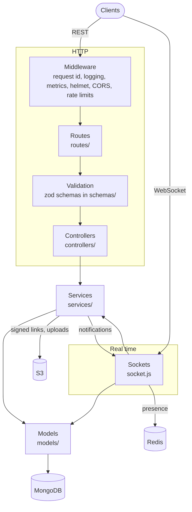
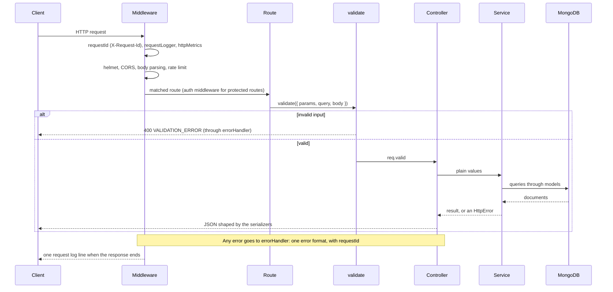

# Architecture

DevSphere is one Node.js process: an Express app and a Socket.IO server sharing
the same HTTP server, with MongoDB for data, Redis (optional) for online
presence and S3 for uploaded files.

## Layers

Code is split into layers. A layer only calls the ones below it.

| Layer       | Folder                                | Responsibility                                                         |
| ----------- | ------------------------------------- | ---------------------------------------------------------------------- |
| Routes      | `routes/`                             | Map a method and path to middleware and a controller                   |
| Validation  | `schemas/`, `middlewares/validate.js` | Check params, query and body with zod before any handler runs          |
| Controllers | `controllers/`                        | Read the validated input, call a service, shape the response           |
| Services    | `services/`                           | The business logic: rules, queries, side effects such as notifications |
| Models      | `models/`                             | Mongoose schemas, indexes and field rules                              |
| Sockets     | `socket.js`                           | Authenticate the handshake, check chat membership, relay events        |
| Utilities   | `utils/`                              | Small helpers with no knowledge of the layers above them               |
| Config      | `config/`                             | The one place that reads environment variables                         |

Rules, checked by `tests/architecture.test.js`:

- Controllers and routes never import models or the database driver.
- Services never import controllers, routes or middleware.
- Utilities never import services, controllers, routes or middleware.
- Models import nothing from the layers above them.

Controllers shape responses with the helpers in `utils/serializers.js`, so what
a client sees (signed media links, public user fields) is decided in one place.
Services get plain values (ids, parsed input, an `io` object for socket
delivery), not Express request or response objects.

## A request

Errors are `HttpError`s thrown anywhere below the routes. `errorHandler` turns
them into `{ error: { code, message, details?, requestId } }`; anything else
becomes a generic 500 and is logged with its stack.

## Real-time events

Socket.IO shares the HTTP server. The handshake needs an access token; after
that each event is validated, checked for chat membership and handled in
`socket.js`. REST requests can reach sockets through the `io` object stored on
the Express app (for example to deliver a notification, close the sockets of a
blocked user or remove a member from a chat room). The events are listed in
[socket-events.md](socket-events.md).

Messages from REST and from sockets go through one function
(`services/chatService.js`), which saves them and emits from the server. The
other real-time state lives in services too: online presence
(`presenceService`), read markers (`readService`) and live code revisions and
saving (`liveCodeService`). With `REDIS_URL` set, the Socket.IO Redis adapter
shares rooms and events between instances, and the rate limit store, presence
and live code working copies use Redis; without it each falls back to memory
(see Scaling in the README). `utils/socketOps.js` applies room commands to the
local sockets as well, so they work while Redis is down.

## Process

`server.js` loads and checks the configuration, connects to MongoDB, starts the
HTTP and Socket.IO servers and installs the shutdown handlers
(`utils/shutdown.js`). `app.js` builds the Express app and is what the tests
import, so they never start a server of their own unless they need one.
